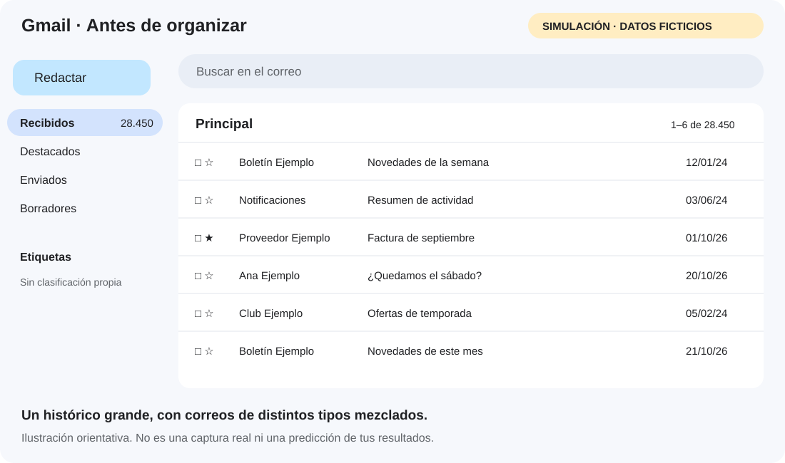
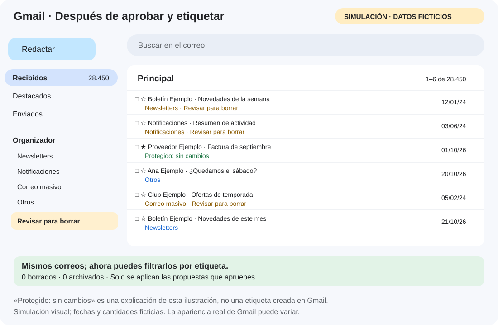

# Referencia del flujo inicial de cabeceras

Documento de consulta de los comandos existentes. Para el objetivo actual y sus limitaciones, lee primero [README](../README.md) y la [especificación](ESPECIFICACION.md).

# Organizador local de email

Base pública para ordenar históricos grandes de Gmail desde tu PC, sin IA de pago ni servidor. Python 3.11 o posterior. Esta versión usa una interfaz de comandos, no dispone de instalador ni interfaz gráfica.

## Empieza aquí: copia privada y ejecución paso a paso

La [guía completa para principiantes](GUIA_PASO_A_PASO.md) explica cómo crear una copia **privada**, descargarla, instalar Python, conectar tu cuenta y comprobar cada resultado.

1. En GitHub: **+ → Import repository**, introduce la URL de este repositorio y elige **Private**. Un fork público no es la vía para crear una copia privada.
2. En tu copia: **Code → Download ZIP** y descomprime en tu PC.
3. Instala Python 3.11 o posterior y abre la terminal en la carpeta del README.
4. Instala las dependencias y configura tu cliente OAuth de Google siguiendo la guía.
5. Ejecuta `gmail-sync`: **solo importa cabeceras**.
6. Ejecuta `classify` y `review`: **solo genera propuestas locales**.
7. Revisa el CSV, escribe `si` en las filas elegidas y ejecuta `approve`.
8. Ejecuta `gmail-apply --confirm`: **añade las etiquetas aprobadas**, sin borrar ni archivar.
9. Abre Gmail y revisa las etiquetas. Tú decides después si eliminas algún correo desde Gmail.

**Coste de IA: cero.** Esta versión clasifica con reglas locales. El PC necesita Internet para Google y debe estar encendido mientras se ejecuta cada comando.

## Antes y después: simulación SVG

Son ilustraciones con mensajes y cantidades ficticias; no capturas de una cuenta real. Representan el resultado después de revisar y aprobar propuestas. La bandeja mantiene la misma cantidad de mensajes porque el programa no los archiva ni borra.

### Antes: histórico mezclado



### Después: categorías y candidatos visibles



Puedes abrir o descargar los archivos [antes.svg](images/gmail-antes.svg) y [despues.svg](images/gmail-despues.svg). Las etiquetas se crean solo si hay mensajes aprobados que las necesiten. «Conservar» es una decisión local de protección; no se crea una carpeta Gmail con ese nombre.

## Qué funciona

**Nuevo: organización temática y por entidad.** Además de las categorías de limpieza, ahora hay etiquetas anidadas `Organizador/Temas/Tema/Subtema` y `Organizador/Entidades/dominio`. El flujo de [descubrimiento de ontología e IA opcional](ONTOLOGIA_E_IA.md) inventaría el histórico antes de proponer una estructura. Informa de la cobertura real y guarda un borrador revisable. Sigue trabajando solo con cabeceras; no analiza todavía los cuerpos de los mensajes.

El [diseño del motor semántico](MOTOR_SEMANTICO_PROPUESTO.md) describe el siguiente paso: embeddings locales, agrupación del histórico y un clasificador para el correo nuevo. Ese motor aún no está implementado.

Consulta el [procedimiento y protocolo de calidad](METODO_Y_CALIDAD.md): referencias a métodos establecidos, comparación de modelos y evaluación independiente. Todavía no hay una cifra demostrada de precisión sobre correo real; las pruebas funcionales no acreditan calidad semántica.

- Importación local de MBOX (por ejemplo, una exportación de Google Takeout).
- Conexión opcional a Gmail mediante OAuth de escritorio.
- Clasificación por lotes reanudable y estimación del tiempo de clasificación local.
- Propuestas en CSV, aprobación por mensaje y aplicación de etiquetas en Gmail.
- Etiquetas `Organizador/Newsletters`, `Organizador/Notificaciones`, `Organizador/Correo masivo`, `Organizador/Otros` y `Organizador/Revisar para borrar`.
- Sin borrado, movimiento a papelera, archivado ni apertura de adjuntos o enlaces.

**«Revisar para borrar» es una etiqueta de candidatos, no una orden de eliminación.** Gmail usa etiquetas, no carpetas tradicionales. Los criterios son orientativos: no existe un criterio universal que garantice que un correo es prescindible.

## Inicio sin conectar ninguna cuenta

Desde la carpeta del repositorio:

```sh
python -m email_organizer.cli import-mbox /ruta/historico.mbox
python -m email_organizer.cli classify
python -m email_organizer.cli review
```

En Windows puede utilizarse `py` en lugar de `python`. Abre `data/review.csv` con una hoja de cálculo. La importación guarda solo cabeceras; no modifica el MBOX. El archivo original puede contener datos privados: guárdalo fuera del repositorio.

## Conectar Gmail

1. Crea tu propio proyecto en Google Cloud y habilita Gmail API.
2. Configura la pantalla de consentimiento OAuth; en modo de pruebas añade tu cuenta como usuario de prueba.
3. Crea un cliente OAuth de tipo **aplicación de escritorio** y descarga su JSON a `data/credentials.json`. No lo subas a Git.
4. Instala las dependencias en un entorno virtual:

```sh
python -m venv .venv
# Linux/macOS
source .venv/bin/activate
# En Windows PowerShell, en su lugar: .venv\Scripts\Activate.ps1
python -m pip install -e '.[gmail]'
python -m email_organizer.cli gmail-sync
python -m email_organizer.cli classify
python -m email_organizer.cli review
```

Se abrirá el navegador para autorizar tu cuenta. Los tokens se guardan en el llavero seguro del sistema: Windows Credential Locker, macOS Keychain o Secret Service/KWallet en Linux. Si no hay un llavero compatible, la conexión se detiene; no se guarda el token en texto plano. Esta versión mantiene una sola sesión OAuth por usuario del sistema.

El permiso `gmail.modify` permite modificar el correo; se solicita para crear y aplicar etiquetas. El código de esta versión solo añade etiquetas. Una aplicación OAuth pública puede requerir verificación de Google. Los tokens de proyectos en modo pruebas pueden caducar y requerir nueva autorización.

## Revisar y aplicar

En el CSV escribe `si` en la columna `aprobar` de cada propuesta que quieras aplicar. No cambies `source` ni `id`.

```sh
python -m email_organizer.cli approve data/review.csv
python -m email_organizer.cli gmail-apply --confirm
```

Solo se aplican propuestas aprobadas de la cuenta conectada. Se vuelven a comprobar mensajes destacados, importantes, enviados, borradores, spam y papelera antes de etiquetar. Puedes quitar manualmente las etiquetas en Gmail; esta versión no incorpora deshacer automático. El registro local `events` guarda las etiquetas añadidas.

## Opciones y criterios

Edita [config/criterios.json](../config/criterios.json):

| Criterio | Valor inicial | Resultado |
| --- | --- | --- |
| Cabecera List-Unsubscribe | Cualquier antigüedad | Newsletters |
| Newsletter antigua | 180 días | También candidata a revisar para borrar |
| Remitente de notificaciones | 365 días | Candidata a revisar para borrar |
| Cabecera Precedence bulk/list/junk | 365 días | Candidata a revisar para borrar |
| Destacado, importante o palabras protegidas | Siempre | Conservar, sin aplicación |
| Fecha desconocida o correo sin señales suficientes | Siempre | No proponer borrado |

Las palabras protegidas incluyen facturas, pagos, salud, seguridad y documentos legales. Añade remitentes personales a `protected_senders`; la coincidencia se hace por texto parcial, por lo que una protección amplia puede conservar más mensajes de los necesarios. No se analiza el cuerpo: un documento importante no señalado en el asunto puede pasar inadvertido. Revisa siempre las propuestas.

Tras cambiar criterios:

```sh
python -m email_organizer.cli classify --recalculate --batch-size 200
python -m email_organizer.cli review
```

Recalcular elimina aprobaciones de propuestas aún no aplicadas. No retira etiquetas ya aplicadas. Puedes detener con Ctrl+C y repetir: los lotes confirmados y mensajes importados se conservan. Gmail vuelve a enumerar el buzón y omite IDs conocidos; todavía no usa `historyId` ni refleja cambios o eliminaciones de mensajes ya importados. Para una revisión nueva del estado completo, utiliza otra base con `--db data/otra.sqlite` antes del subcomando.

## Privacidad y costes

Por defecto no se envía nada a proveedores de IA. Los comandos opcionales `ai-ontology` y `ai-classify` requieren consentimiento explícito y pueden generar costes API. Consulta qué datos envía cada uno en la [guía de IA](ONTOLOGIA_E_IA.md). No necesitas cuenta de GitHub para ejecutarlo ni copiar el repositorio a privado. `data/`, MBOX, tokens y credenciales están excluidos de Git. La base contiene remitentes y asuntos sin cifrar: protege tu sesión, usa cifrado de disco y no compartas CSV o copias de seguridad. No ejecutes el programa en un equipo compartido sin protección.

El PC debe permanecer encendido. No hay un servicio programado de fondo todavía: cada comando termina al completar su trabajo. El tiempo estimado corresponde solo a clasificación local; no incluye OAuth, descarga ni aplicación de etiquetas.

## Validación y próximos pasos

```sh
python -m unittest discover -s tests -v
```

Pendientes: conexión Hotmail/Outlook mediante Microsoft Graph, interfaz gráfica, programador de ciclos, sincronización Gmail por historyId, deshacer automático y análisis semántico de cuerpos. El importador MBOX puede utilizarse con exportaciones compatibles, pero no equivale a una conexión Outlook.

Nunca incluyas datos reales en incidencias, pruebas o contribuciones.
